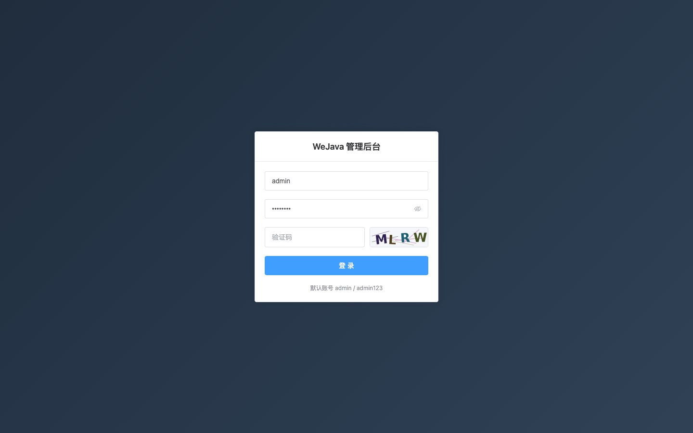
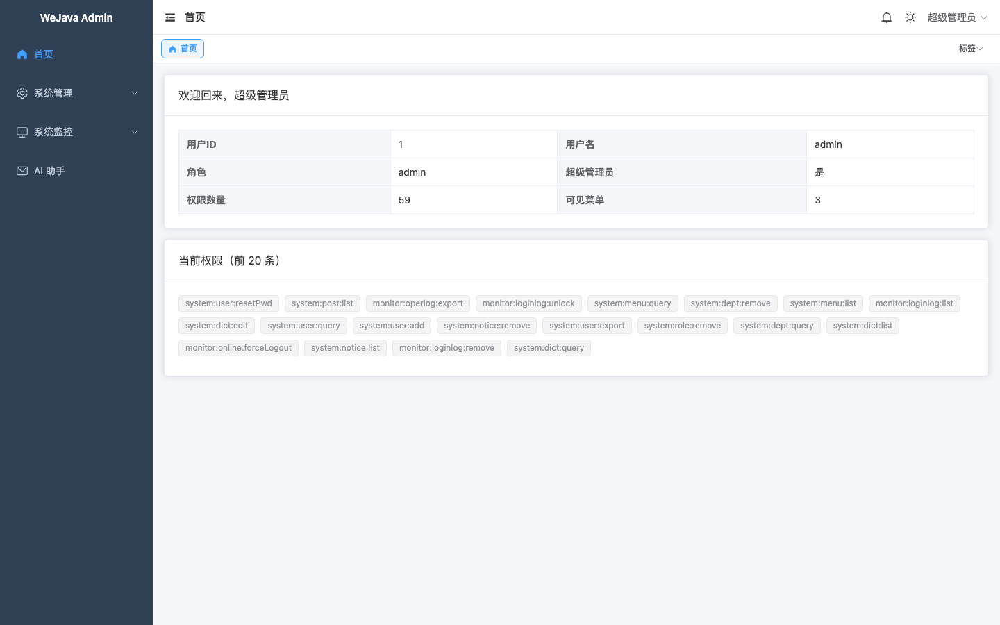
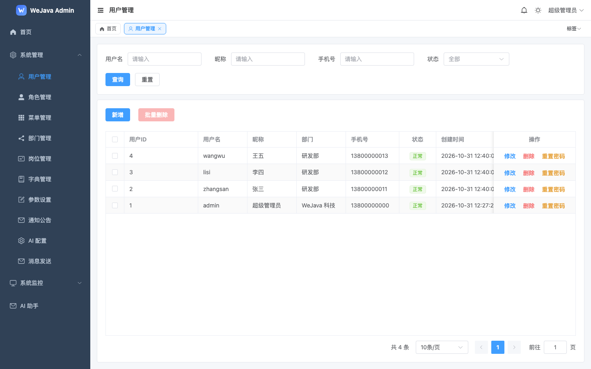
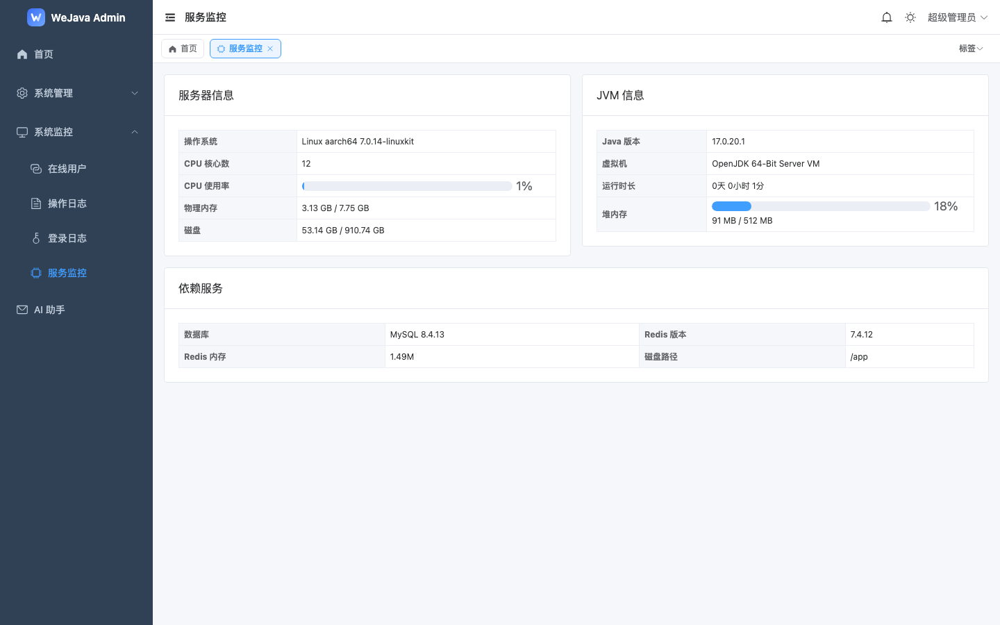

[简体中文](README.zh-CN.md) | English

# WeJavaAdmin

An admin dashboard framework built on **Spring Boot 4.1 + Spring Security 7.1 + MyBatis-Plus + Vue 3**.

Authentication uses a **self-managed JWT with a Redis session whitelist** — no OAuth2 authorization server, which keeps the auth path short and removes a moving part.

[](https://github.com/aliaoxxx/wejava/actions/workflows/ci.yml)
[](LICENSE)
[](#tech-stack)
[](#tech-stack)

## Screenshots

<table>
  <tr>
    <td width="50%"></td>
    <td width="50%"></td>
  </tr>
  <tr>
    <td width="50%"></td>
    <td width="50%"></td>
  </tr>
</table>

## Quick Start (30 seconds)

No JDK / Node / MySQL / Redis required — one command starts everything:

```bash
git clone https://github.com/aliaoxxx/wejava.git && cd wejava
docker compose up -d
open http://localhost:3300/     # Windows: start http://localhost:3300/
```

Sign in with `admin / admin123`.

> The first run pulls images and compiles the backend/frontend inside containers (**5–10 minutes** depending on network).
> After that, `docker compose up -d` is ready in about **20 seconds**.

The database, tables and seed data are created automatically by Flyway on first start — **no manual SQL needed**.

| Service | Role |
|---|---|
| `frontend` | Nginx serving the SPA on host port 3300, proxying `/api` to the backend |
| `backend` | Spring Boot app (`docker` profile, context path `/api`) |
| `mysql` | MySQL 8.4, data persisted in the `mysql-data` volume |
| `redis` | Redis 7, reachable only inside the compose network |

Common commands:

```bash
docker compose logs -f backend   # follow backend logs
docker compose ps                # health status
docker compose down              # stop, keep data
docker compose down -v           # stop and drop volumes — next start is a clean environment
```

To change ports, passwords or secrets: `cp .env.example .env`, edit, then `docker compose up -d`.

> MySQL and Redis are not published to the host. To connect from your machine for debugging,
> add `ports: ["127.0.0.1:3307:3306"]` to the service in `docker-compose.yml`.

## Features

**Authentication & security**

- Dual tokens: 30-minute access token, 7-day refresh token with **rotation**; account status is re-checked on every refresh
- Redis-backed session whitelist, force logout, optional single-session login
- Image captcha, login lockout (5 failures / 15 minutes), BCrypt password hashing

**Authorization**

- RBAC: users / roles / menus / departments / posts
- Dynamic routing: the menu tree is served by the backend and components are registered on the fly
- Button-level permissions via the `v-hasPerm` directive; super admin gets the `*:*:*` wildcard
- **Row-level data permission**: the `@DataScope` annotation rewrites SQL through JSqlParser — all / custom / own department / own department and below / self only

**Protection**

- Concurrency limit per (IP + user) backed by Redis counters; the limit is configurable at runtime
- Per-endpoint QPS limiting (fixed window); returns HTTP 429 with a `Retry-After` header

**Observability**

- Operation log: the `@OperLog` aspect writes asynchronously, with password fields masked
- Login logs, online users, server metrics (CPU / memory / JVM / disk / DB / Redis)
- Global TraceId, unified response envelope, global exception handling

**Frontend**

- **Schema-driven CRUD**: a single `schema.ts` produces a full create/read/update/delete page
- Multi-tab navigation, light/dark/system themes, accent colors, motion levels
- Tree pages: menus / departments / dictionaries (master-detail)

## Tech Stack

| Layer | Choice | Version |
|---|---|---|
| JDK | Temurin / Oracle | 17 |
| Framework | Spring Boot | 4.1.2 (Spring Framework 7.0.10) |
| Security | Spring Security | 7.1.2 |
| ORM | MyBatis-Plus | 3.5.18 (with mybatis-plus-jsqlparser) |
| Object mapping | MapStruct | 1.6.3 |
| Database | MySQL | 8.4+ (verified on 9.6) |
| Migration | Flyway | Boot BOM |
| Cache | Redis | 7.0+ (verified on 8.3) |
| Frontend | Vue | 3.5 |
| Build tool | Vite | 6 |
| Language | TypeScript | 5.7 |
| UI | Element Plus | 2.9 |
| State | Pinia | 2.3 |

> **Two things changed in Boot 4**: the JSON library is Jackson 3 (package `tools.jackson.*`), and several starters were renamed — for example `spring-boot-starter-webmvc` and `spring-boot-starter-aspectj`.
>
> Virtual threads require JDK 21. This project targets JDK 17 and does not use them.

## Documentation

Design documents are available in both languages:

- **English** — [docs/en/README.md](docs/en/README.md)
- **中文** — [docs/README.md](docs/README.md)

The table below lists the Chinese originals; every one has an English counterpart under `docs/en/`.

- [数据库设计](docs/01-数据库设计.md) — database design
- [认证与权限设计](docs/02-认证与权限设计.md) — authentication and authorization
- [接口设计](docs/03-接口设计.md) — API design
- [前端设计](docs/04-前端设计.md) — frontend design
- [开发规范](docs/05-开发规范.md) — development conventions
- [前端配置驱动设计](docs/06-前端配置驱动设计.md) — schema-driven frontend
- [部署方案](docs/07-部署方案.md) — deployment
- [避坑清单](docs/避坑清单.md) — pitfalls checklist
- [演示脚本](docs/demo-script.md) — 60-second demo storyboard

## Requirements

| Dependency | Version | Notes |
|---|---|---|
| JDK | 17+ | Minimum for Boot 4 |
| Maven | 3.9+ | |
| Node | 20+ | Required by Vite 6 |
| pnpm | 9+ | |
| MySQL | 8.4+ | `utf8mb4` required |
| Redis | 7.0+ | |

## Local Development (without Docker)

```bash
# 1. Create the database once; tables and seed data are migrated by Flyway
mysql -uroot -p -e "CREATE DATABASE wejava DEFAULT CHARSET utf8mb4;"

# 2. Backend: port 8000, context path /dev/api
cd wejava-backend
mvn spring-boot:run

# 3. Frontend: http://localhost:3300/dev/
cd wejava-frontend
pnpm install && pnpm dev
```

Open <http://localhost:3300/dev/> and sign in with `admin / admin123`.

Connections default to localhost and can be overridden with environment variables:

```
DB_HOST  DB_PORT  DB_NAME  DB_USER  DB_PASSWORD
REDIS_HOST  REDIS_PORT  REDIS_PASSWORD
```

> After the first clone, `src/types/auto-imports.d.ts` does not exist yet and your IDE may report type errors. Running `pnpm dev` or `pnpm build` once generates it (the file is not committed).
>
> To skip the captcha while developing locally, start with `CAPTCHA_ENABLED=false mvn spring-boot:run`.

Flyway seeds 64 menus, 2 roles and 1 account (`admin`, super admin). Create extra accounts from the user management page.

## Project Structure

```
wejava/
├── docker-compose.yml        one-command demo stack (MySQL + Redis + backend + frontend)
├── deploy/                   nginx config used by the demo image
├── docs/                     design documents (Chinese)
│   ├── 01-数据库设计.md       DDL and seed data for the 20 tables
│   ├── 02-认证与权限设计.md    authentication and authorization
│   ├── 03-接口设计.md          API design
│   ├── 04-前端设计.md          frontend design
│   ├── 05-开发规范.md          layering, file granularity, naming
│   ├── 06-前端配置驱动设计.md   schema-driven CRUD
│   ├── 07-部署方案.md          WAR + Nginx deployment
│   ├── screenshots/            screenshots referenced by the README
│   └── 避坑清单.md             pitfalls checklist
├── wejava-backend/           Java backend (package com.wejava)
│   └── src/main/java/com/wejava/
│       ├── ai/               AI chat: client / service / controller / mapper
│       ├── common/           response envelope, exceptions, AOP, utilities
│       ├── security/         auth infrastructure (must not depend on system)
│       └── system/           business: controller / service / mapper / converter / model
└── wejava-frontend/          Vue frontend
    └── src/
        ├── api/              request wrappers
        ├── components/Crud/  schema-driven CRUD components
        ├── hooks/useCrud.ts
        ├── layout/           layout, sidebar, tabs
        ├── router/           dynamic routes and guards
        ├── store/modules/    user / permission / app / tagsView / theme
        └── views/            pages
```

## Development

```bash
cd wejava-backend
mvn spotless:apply          # code formatting (required before committing)
mvn test                    # unit tests
./scripts/verify-auth.sh    # 14-case auth acceptance suite (start with CAPTCHA_ENABLED=false)
```

Frontend type checking and build:

```bash
cd wejava-frontend
pnpm build      # vue-tsc in strict mode, then Vite build
```

## Build & Deploy

```bash
# Backend: WAR (prod#api.war deploys under the /prod/api context)
mvn clean package -Pprod -DskipTests

# Frontend: base path /prod/, output in dist/
pnpm build
```

Path convention: `/prod/` in production, `/dev/` in development. Tomcat resolves the `#`
in a WAR filename to `/`, so `prod#api.war` is served under `/prod/api`.

See [docs/07-部署方案.md](docs/07-部署方案.md) for the WAR + Tomcat setup (directory layout, Nginx, release and rollback).

For a public instance, read [deploy/README.md](deploy/README.md): three deployment paths (VPS / Render / Alibaba Cloud), HTTPS, and a security baseline for public demos.

## License

[MIT](LICENSE) © 2026 ZHAO ZHENYU
