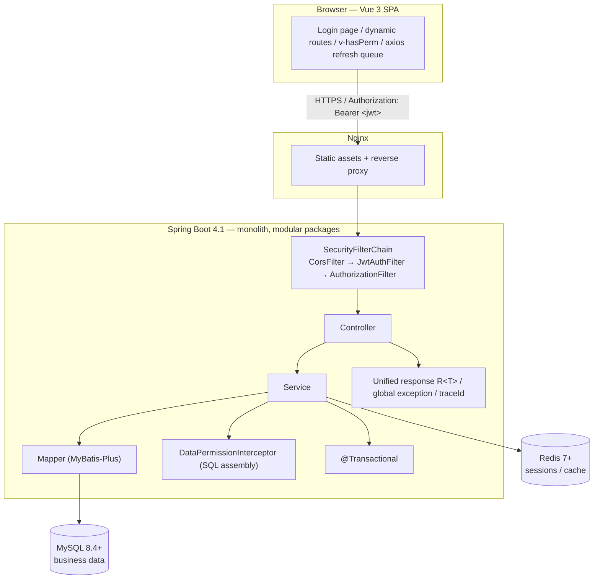

[中文](../README.md) | English

# WeJavaAdmin Design Documentation

An admin framework built on **Spring Boot 4.1 + Spring Security 7 + MyBatis-Plus + Vue 3**.
The authentication scheme is **self-managed JWT + Redis session whitelist** (no OAuth2 authorization server).

---

## Document Index

| Document | Contents | Chinese |
|---|---|---|
| [01-database-design](01-database-design.md) | Complete DDL for 15 tables, indexes, data permission columns, seed data | [01-数据库设计](../01-数据库设计.md) |
| [02-auth-and-permissions](02-auth-and-permissions.md) | Login sequence, token structure, Redis conventions, filter chain, RBAC, data permission | [02-认证与权限设计](../02-认证与权限设计.md) |
| [03-api-design](03-api-design.md) | Unified response body, error codes, full endpoint list, permission string table | [03-接口设计](../03-接口设计.md) |
| [04-frontend-design](04-frontend-design.md) | Directory structure, dynamic routes, axios refresh queue, permission directive | [04-前端设计](../04-前端设计.md) |
| [05-development-conventions](05-development-conventions.md) | Layering, naming, DTO/VO/Converter, pagination, transactions, MyBatis-Plus and XML conventions | [05-开发规范](../05-开发规范.md) |
| [06-schema-driven-crud](06-schema-driven-crud.md) | CRUD schema, useCrud, three-layer strategy, rollout order | [06-前端配置驱动设计](../06-前端配置驱动设计.md) |
| [07-deployment](07-deployment.md) | WAR + Nginx deployment, path prefix, release and rollback | [07-部署方案](../07-部署方案.md) |
| [pitfalls](pitfalls.md) | Risk items to check one by one before going live | [避坑清单](../避坑清单.md) |

---

## 1. Tech Stack

| Layer | Choice | Version | Notes |
|---|---|---|---|
| Runtime | JDK | 17 | Minimum requirement for Boot 4; virtual threads need 21 and are not enabled for now |
| Framework | Spring Boot | 4.1.2 | |
| Security | Spring Security | 7.1.2 | Authentication + authorization only, no authorization-server |
| ORM | MyBatis-Plus | 3.5.18 | `mybatis-plus-spring-boot4-starter` + `mybatis-plus-jsqlparser` |
| Database | MySQL | 8.4+ | 8.0 is EOL; locally verified on 9.6 |
| Migration | Flyway | Managed by Boot | `spring-boot-starter-flyway` must be added explicitly |
| Cache | Redis | 7.0+ | Sessions, captcha, rate limiting, locks |
| Connection pool | HikariCP | Managed by Boot | Druid is not used |
| API documentation | springdoc-openapi | 3.x | Enabled in dev only, disabled in production |
| Frontend | Vue + Vite + TS | 3.5 / 6 / 5.7 | |
| UI | Element Plus | 2.9 | |
| State | Pinia | 2.3 | |

---

## 2. Overall Architecture



**Why a monolith**: the complexity of an admin system lies in permissions and business logic, not in service decomposition. A single process with packages split by feature, extracting modules along package boundaries only when splitting is actually needed, costs far less than going microservices from the start.

---

## 3. Module Layout and Dependency Direction

```
com.wejava
├── WeJavaApplication.java
│
├── common/                    # Shared capabilities, depends on no business module
│   ├── core/                  # R<T>, PageResult<T>, BaseEntity
│   ├── exception/             # BizException, ErrorCode, GlobalExceptionHandler
│   ├── web/                   # TraceIdFilter, IpUtils
│   ├── config/                # JacksonConfig, MybatisPlusConfig, WebMvcConfig
│   ├── util/                  # Utility classes
│   └── constant/              # Constants, enums
│
├── security/                  # Authentication and authorization, depends only on common
│   ├── config/                # SecurityConfig, PasswordConfig
│   ├── jwt/                   # JwtService, JwtAuthFilter, SessionStore, LoginAttemptStore
│   ├── handler/               # AuthEntryPoint, AccessDeniedHandler
│   ├── model/                 # LoginSession, AuthUser, Captcha, OnlineSession
│   └── service/               # CaptchaService
│
├── system/                    # System management, depends on common + security
│   ├── controller/            # XxxController
│   ├── service/               # XxxService (interface)
│   ├── service/impl/          # XxxServiceImpl (implementation)
│   ├── mapper/                # XxxMapper
│   ├── converter/             # XxxConverter (MapStruct)
│   └── model/
│       ├── entity/            # SysUser, SysRole ...
│       ├── converter/         # SysUserConverter (MapStruct)
│       ├── query/             # SysUserQuery (extends PageQuery)
│       ├── form/              # SysUserCreateForm / SysUserUpdateForm
│       └── vo/                # SysUserVO
│
└── biz/                       # Business modules (reserved, create packages by domain)
```

**Dependency rules (hard constraints)**:

1. `common` depends on no other module
2. `security` depends only on `common`
3. `system` may depend on `common` and `security`
4. `biz` may depend on `common` and `security`, and **in principle must not depend directly on `system`'s internal implementation** (use interfaces when needed)
5. `system` depending on `biz` in the reverse direction is prohibited

---

## 4. Backend Directory Structure

```
wejava-backend/
├── pom.xml
└── src/main/
    ├── java/com/wejava/
    │   ├── WeJavaApplication.java
    │   ├── common/
    │   │   ├── core/R.java
    │   │   ├── core/PageResult.java
    │   │   ├── core/BaseEntity.java
    │   │   ├── exception/BizException.java
    │   │   ├── exception/ErrorCode.java
    │   │   ├── exception/GlobalExceptionHandler.java
    │   │   ├── web/TraceIdFilter.java
    │   │   ├── web/JacksonConfig.java
    │   │   └── util/
    │   ├── security/
    │   │   ├── config/SecurityConfig.java
    │   │   ├── jwt/JwtService.java
    │   │   ├── jwt/JwtAuthFilter.java
    │   │   ├── jwt/TokenStore.java
    │   │   ├── handler/RestAuthEntryPoint.java
    │   │   ├── handler/RestAccessDeniedHandler.java
    │   │   ├── model/LoginUser.java
    │   │   └── service/AuthService.java
    │   ├── system/
    │   │   ├── user/
    │   │   │   ├── controller/SysUserController.java
    │   │   │   ├── service/SysUserService.java
    │   │   │   ├── mapper/SysUserMapper.java
    │   │   │   ├── entity/SysUser.java
    │   │   │   └── dto/  vo/
    │   │   ├── role/  menu/  dept/  post/
    │   │   ├── dict/  config/  notice/
    │   │   └── log/
    │   └── biz/
    └── resources/
        ├── application.yml
        ├── application-dev.yml
        ├── application-prod.yml
        ├── db/migration/
        │   ├── V1__init_schema.sql
        │   └── V2__init_data.sql
        └── mapper/                  # XML (used only for complex queries)
```

**Layering conventions within a package**: `controller` / `service` (interface) + `service/impl` (implementation) / `mapper` / `converter` / `model/{entity,query,form,vo}`.
`form` is the input, `vo` is the output, `entity` is used for persistence only — **the three are never mixed**, and conversion is performed by MapStruct converters.

---

## 5. Naming and Coding Conventions

| Object | Convention | Example |
|---|---|---|
| Database table | `sys_` / `biz_` prefix + snake_case | `sys_user` |
| Database column | snake_case | `create_time` |
| Java class | PascalCase | `SysUserService` |
| Java field | camelCase | `createTime` |
| Endpoint path | kebab-case, lowercase | `/system/user/reset-pwd` |
| Permission string | `module:entity:action` | `system:user:add` |
| Redis key | `admin:module:purpose:id` | `admin:auth:token:1:uuid` |
| Enum | ALL_CAPS | `ErrorCode.UNAUTHORIZED` |

**Mandatory constraints**:

- Every table must have `create_by/create_time/update_by/update_time`
- Tables that need soft deletion must have `del_flag`
- Amounts use `decimal(18,2)`; `float/double` is prohibited
- Time is uniformly `datetime(3)`, with the time zone fixed to `Asia/Shanghai`
- Primary keys are uniformly `bigint AUTO_INCREMENT` (generated by the database), **converted to String when serialized to the frontend**

---

## 6. Environments and Startup

| Environment | Port | Notes |
|---|---|---|
| MySQL | 3306 | Database name `wejava`, account `wejava` |
| Redis | 6379 | db 0, password required |
| Backend | 8000 | Development context `/dev/api`; production WAR is `/prod/api` |
| Frontend | 3300 | Development access `/dev/`, proxies `/dev/api` to 8000 |

```bash
# 1. Start the backend (Flyway creates the tables and initializes the data)
cd wejava-backend
mvn spring-boot:run

# To run acceptance only, without entering the captcha manually:
# CAPTCHA_ENABLED=false mvn spring-boot:run

# 2. Start the frontend
cd wejava-frontend && pnpm install && pnpm dev
```

All sensitive configuration can be overridden by environment variables; do not hardcode it in configuration files in production:

| Variable | Purpose |
|---|---|
| `DB_HOST` / `DB_PORT` / `DB_NAME` / `DB_USER` / `DB_PASSWORD` | MySQL |
| `REDIS_HOST` / `REDIS_PORT` / `REDIS_PASSWORD` | Redis |
| `JWT_SECRET` | JWT signing secret (**must be ≥ 32 bytes**) |
| `CAPTCHA_ENABLED` | Whether the image captcha is enabled, default `true` |

Default account: `admin / admin123` (super administrator with all permissions).

### M2 Acceptance Script

```bash
# The application must be started with CAPTCHA_ENABLED=false
cd wejava-backend
./scripts/verify-auth.sh
```

Covers 14 cases: login, authorization, tampered signature, token type confusion, refresh rotation, permission denied (403), logout revocation, brute-force lockout.

> The 403 case requires a `tester` account to exist in the database (role `common`, no permissions).
> See the header comment of `scripts/verify-auth.sh` for how to create it; if the account is missing, the script skips this case automatically.

---

## 7. Delivery Milestones

| Stage | Contents | Status |
|---|---|---|
| M1 | Project skeleton, unified response, exceptions, traceId, Flyway, 15 tables | ✅ Done |
| M2 | Authentication: login/refresh/logout/captcha/brute-force protection/Redis session/RBAC wiring | ✅ Done |
| M2.5 | Development conventions, BaseEntity/PageQuery/audit fill, MapStruct, Spotless | ✅ Done |
| M3-1 | Backend RBAC: user/role/menu CRUD + dynamic route endpoints | ✅ Done |
| M3-2 | Frontend base: Vue project, login page, layout, dynamic routes, axios | ✅ Done |
| M3-3 | Schema-driven: CrudPage four-piece set + user/role pages + menu tree page + multi-tab | ✅ Done |
| M4 | Department/post/dictionary/parameter/notice | ✅ Done |
| M5 | Logs (operation/login) + online users + monitoring | ✅ Done |
| M6 | Data permission, rate limiting, export | ✅ Done |
| M7 | Frontend layout, multi-tab, theme, packaging and deployment | ✅ Done (deployment verification pending a server) |
